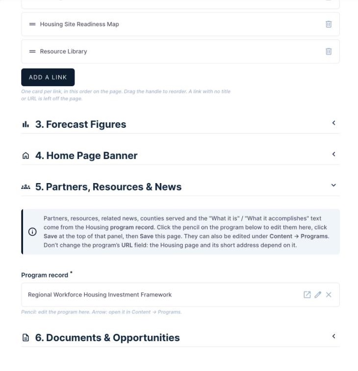
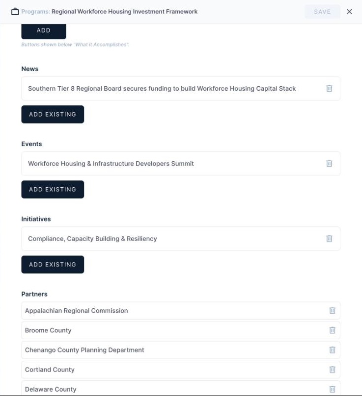
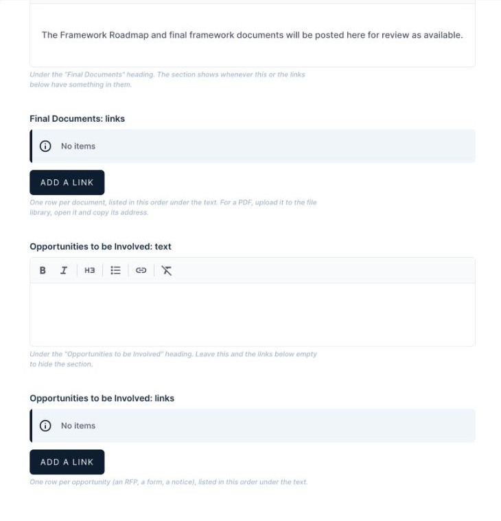

# How to edit the Housing page

**In short:** In Directus, open **Site Pages → Housing** in the left sidebar. Make your changes, then click **Save** at the top right. Click the **Preview** button (the eye icon at the top) to see the live page.

## Before you start

- Log in at https://manage.southerntier8.org with your own login.
- You need the **Content Editor** role. If you can't see **Housing** under **Site Pages**, ask Peter.

## Open the page

1. In the left sidebar, under **Site Pages**, click **Housing**.
2. It opens straight away. There is only one page, so there's no list.
3. You'll see six sections. Click a section's heading to open or close it.
   - **1. Page**: title, photo and share text
   - **2. Framework Tools**: the Explore the Framework Tools section
   - **3. Forecast Figures**: numbers for the Housing Forecast pages
   - **4. Home Page Banner**
   - **5. Partners, Resources & News**: the program record behind the page
   - **6. Documents & Opportunities**: the Final Documents and Opportunities to be Involved sections

How the page is laid out, top to bottom, and where each part is edited:

| On the page | Edited in |
|---|---|
| Program title, photo, counties and initiative served | 1. Page (counties and initiative: section 5) |
| About the Program, What the Framework Delivers | 5. Partners, Resources & News (the program's What Is It and What It Accomplishes) |
| Explore the Framework Tools | 2. Framework Tools |
| Final Documents, Opportunities to be Involved | 6. Documents & Opportunities |
| Partners, Related Resources, Related News | 5. Partners, Resources & News |

## Save and preview

1. Click **Save** at the top right.
2. Click **Preview** to open the live page at https://southerntier8.org/economic-development-programs/housing
3. Changes show on the next page load. You don't need a developer.

The short address **southerntier8.org/programs/housing** (the one on QR codes and handouts) always goes to this page.

## 1. Page

- **Page title:** the big heading at the top, after "Program:". Now "Regional Workforce Housing Investment Framework".
- **Subtitle:** optional; a short line under the heading. Empty for now.
- **Page image:** the large photo at the top. Landscape, at least 1600 px wide. Leave it empty to use the program's first photo.
- **Share description:** shows when someone shares the page on social media or in a text message. 160 characters at most.

## 2. Framework Tools

This is the **Explore the Framework Tools** section: a short intro, then one card per link.

**Intro above the cards** is the text under the heading. Use the toolbar for bold, italic, headings, bullet lists, links and clear formatting. Pasting from Word is fine; the formatting is cleaned up for you. Links to other websites open in a new tab.

In **Framework links**, each row is one card. Cards show in list order.

- **Add a link:** adds a new row.
- **Click a row** to open it and edit it. When you're done, click **Save** at the top of that panel, then save the whole page with the main **Save** button.
- **Drag the handle** (the two lines on the left) to change the order.
- **Delete** a row with its trash icon.

Each row has these fields:

- **Title** (required): the card's heading.
- **Type**: Overview, Dashboard, Map, Library, Report, Get involved (a form) or Other. This sets the card's icon.
- **Description**: 200 characters at most.
- **Link (url)** (required): must start with https://. Copy it from the browser's address bar.
- **Button Text**: e.g. "Open the dashboard". Left empty, the button says "Open".

Card buttons open in a new tab. A row with no title or link is left off the page, so it never shows as a broken card.

## 3. Forecast Figures

These numbers appear only on the Housing Forecast pages (southerntier8.org/regional-housing-forecast). They are not on the Housing page, and those pages are no longer linked from the menus.

When CommunityScale posts new numbers, copy them from the dashboard at https://southerntierny.communityscale.io/dashboard:

1. Update **Figures as of** (e.g. "November 2026").
2. Under **Headline figures**, update the four figures at the top of the dashboard (median income, population, jobs and building permits). Fill in each one's **Value**, **Label** and **Source**.
3. Update the three five-year need numbers: **Five-year need: total**, **Five-year need: replacement housing** and **Five-year need: shortages in existing stock**.

If a box is left empty, the site shows the last figures built in, so the page never goes blank.

## 4. Home Page Banner

- **Show on home page:** untick the box (and save) to hide the banner. Nothing is deleted, so you can tick it again at any time.
- **Banner image:** a wide photo, ideally 1600 × 600 pixels. Uploads go to the "Housing" folder in the file library. Left empty, the banner uses the page image, or shows a plain navy band if there is none.
- **Banner title:** a few words, shown large.
- **Banner text:** one short line, about 140 characters at most.

The whole banner links to the Housing page.

## 5. Partners, Resources & News

The Housing page also shows the **About the Program** and **What the Framework Delivers** text, partners, related resources, related news, and the counties and initiative served. These are stored on the Housing **program record**, the same as on every program page, and this section lets you edit that record without leaving the Housing page. In the program, About the Program is the **What Is It** field and What the Framework Delivers is **What It Accomplishes**.

1. Click the **pencil** on **Program record**. The program opens in a panel on the right.
2. Scroll to **News**, **Partners**, **Counties**, **Initiatives** or **Resources**. Use **Add Existing** to link one, or the trash icon to unlink it. Edit **What Is It** and **What It Accomplishes** here too. To add a resource that doesn't exist yet, create it under **Content → Resources** first.
3. Click **Save** at the top of the panel, then **Save** the Housing page.

- The **open** icon (box with an arrow) opens the same record under **Content → Programs** instead.
- Don't click the **x**: it unlinks the program, and the page won't save without one.
- Don't change the program's **URL** field (it says "housing"). The Housing page and its short address depend on it.
- Only **published** partners, resources and news show on the page.
- **Explore Our Programs** at the bottom lists every other published program automatically; there's nothing to edit for it.

## 6. Documents & Opportunities

Two sections that fill in as the project goes on. Each has a short text and a list of links.

- **Final Documents: text** shows under the "Final Documents" heading. It says the Roadmap and final documents will be posted here.
- **Final Documents: links**: add one row per document with **Add a link**. Each row has a **Title**, a **Link (URL)** starting with https://, and an optional one-line **Description**. For a PDF, upload it to the file library, open it, and copy its address.
- **Opportunities to be Involved: text** and **links** work the same way. The section stays hidden until one of them has something in it, so it appears as soon as you add the first text or link (for example, the fund administrator procurement).
- Links in both lists open in a new tab.

## The other Site Pages

**Home**, **Organization** and **How to Apply** sit beside Housing under **Site Pages**. Each field there has a note saying where it shows on the site, and the labels match the headings on the pages (for example, **Our Vision** and **Our Approach** on the Organization page). **How to Apply** is the page called **ARC Opportunities** on the site. The **Preview** button on each one opens that page.

## Before the summit (11/18)

- [ ] **Page image:** upload one.
- [ ] **Banner image:** upload one.
- [ ] **Banner title:** "Housing in the Southern Tier" is a stand-in; change it if you'd like.
- [ ] **Housing Site Readiness Map card:** its description ("Where development is best suited across the region.") was written for you; edit it if needed.
- [ ] **Nominate a Partner and Pledge Support:** when the CommunityScale forms are live, add a card for each in **2. Framework Tools** (Type: Get involved), and add the sentence "Organizations that want to take part can nominate a partner or pledge support for the framework." to the intro.
- [ ] **Opportunities to be Involved:** add text when you're ready; the section appears then.
- [ ] **After the summit:** untick **Show on home page**.

## When the page is shared on Facebook

Facebook keeps its own copy of a page's title, description and image, and doesn't notice when they change. After you change the **Page image**, **Page title**, **Subtitle** or **Share description**, refresh Facebook's copy:

1. Go to https://developers.facebook.com/tools/debug/ (log in with your Facebook account).
2. Paste the address, click **Debug**, then click **Scrape Again**.
3. Do it for each of these:
   - https://southerntier8.org/economic-development-programs/housing
   - https://southerntier8.org/programs/housing

LinkedIn has the same tool at https://www.linkedin.com/post-inspector/.
