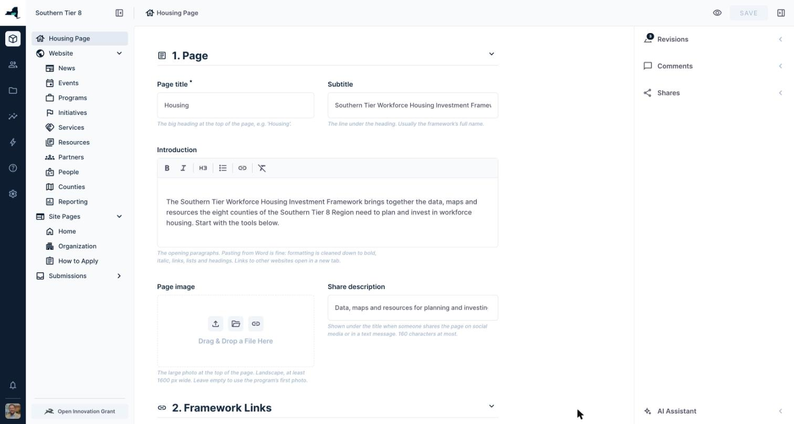
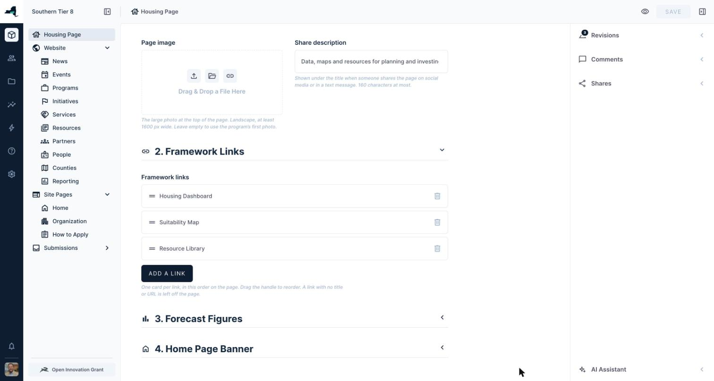
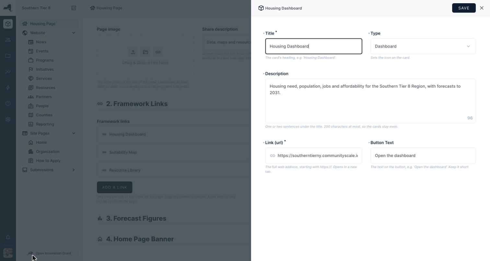
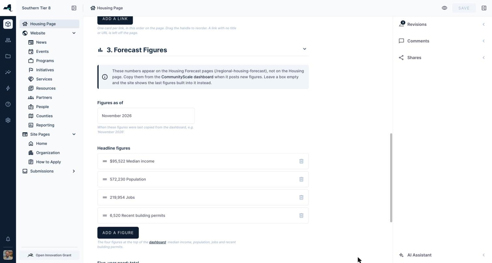
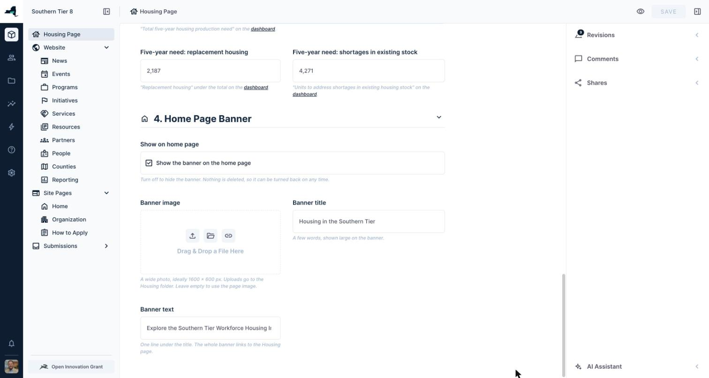

# How to edit the Housing page

**In short:** In Directus, open **Housing Page** at the top of the left sidebar. Make your changes, then click the checkmark at the top right to save. Click the **Preview** button (the eye icon at the top) to see the live page.

## Before you start

- Log in at https://manage.southerntier8.org with your own login.
- You need the **Content Editor** role. If you can't see **Housing Page**, ask Peter.

## Open the page

1. Click **Housing Page** at the top of the left sidebar.
2. It opens straight away. There is only one page, so there's no list.
3. You'll see four sections. Click a section's heading to open or close it.
   - **1. Page**
   - **2. Framework Links**
   - **3. Forecast Figures**
   - **4. Home Page Banner**

## Save and preview

1. Click the checkmark at the top right to save.
2. Click **Preview** to open the live page at https://southerntier8.org/economic-development-programs/housing
3. Changes show on the next page load. You don't need a developer.

The short address **southerntier8.org/programs/housing** (the one on QR codes and handouts) always goes to this page.

## 1. Page

- **Page title:** the big heading at the top, e.g. "Housing".
- **Subtitle:** the line under the heading. Usually the framework's full name.
- **Introduction:** the opening paragraphs. Use the toolbar for bold, italic, headings, bullet lists, links and clear formatting. Pasting from Word is fine; the formatting is cleaned up for you. Links to other websites open in a new tab.
- **Page image:** the large photo at the top. Landscape, at least 1600 px wide. Leave it empty to use the program's first photo.
- **Share description:** shows when someone shares the page on social media or in a text message. 160 characters at most.

## 2. Framework Links

Each row is one card on the page. Cards show in list order.

- **Add a link:** adds a new row.
- **Click a row** to open it and edit it. When you're done, click **Save** at the top of that panel, then save the whole page with the main **Save** button.
- **Drag the handle** (the two lines on the left) to change the order.
- **Delete** a row with its trash icon.

Each row has these fields:

- **Title** (required): the card's heading.
- **Type**: Dashboard, Map, Library, Report or Other. This sets the card's icon.
- **Description**: 200 characters at most.
- **Link (url)** (required): must start with https://. Copy it from the browser's address bar.
- **Button Text**: e.g. "Open the dashboard". Left empty, the button says "Open".

Card buttons open in a new tab. A row with no title or link is left off the page, so it never shows as a broken card.

## 3. Forecast Figures

These numbers appear only on the Housing Forecast pages (southerntier8.org/regional-housing-forecast). They are not on the Housing page, and those pages are no longer linked from the menus.

When CommunityScale posts new numbers, copy them from the dashboard at https://southerntierny.communityscale.io/dashboard:

1. Update **Figures as of** (e.g. "November 2026").
2. Under **Headline figures**, update the four figures at the top of the dashboard (median income, population, jobs and building permits). Fill in each one's **Value**, **Label** and **Source**.
3. Update the three five-year need numbers: **Five-year need: total**, **Five-year need: replacement housing** and **Five-year need: shortages in existing stock**.

If a box is left empty, the site shows the last figures built in, so the page never goes blank.

## 4. Home Page Banner

- **Show on home page:** untick the box (and save) to hide the banner. Nothing is deleted, so you can tick it again at any time.
- **Banner image:** a wide photo, ideally 1600 × 600 pixels. Uploads go to the "Housing" folder in the file library. Left empty, the banner uses the page image, or shows a plain navy band if there is none.
- **Banner title:** a few words, shown large.
- **Banner text:** one short line, about 140 characters at most.

The whole banner links to the Housing page.

## Behind the scenes

The Housing page also shows partners, resources, related news, counties served, and the "What it is" and "What it accomplishes" text. Those aren't edited here: they come from the program record under **Website → Programs** (the program whose URL is "housing", currently titled "Southern Tier's Capital Stack for Workforce Housing"). Edit them there as you would for any program. Don't change that program's URL field, because the Housing page and its short address depend on it.

## Before the summit (11/18)

- [ ] **Introduction:** replace the stand-in text with Beth's page copy.
- [ ] **Page image:** upload one.
- [ ] **Banner image:** upload one.
- [ ] **Banner title and banner text:** replace the stand-ins.
- [ ] **Dashboard and Suitability Map links:** check they're the addresses Beth wants (they point at CommunityScale's /dashboard and /map pages).
- [ ] **Resource Library link:** it points at the CommunityScale project home for now. Replace it with the real address when CommunityScale sends it.
- [ ] **After the summit:** untick **Show on home page**.

## When the page is shared on Facebook

Facebook keeps its own copy of a page's title, description and image, and doesn't notice when they change. After you change the **Page image**, **Page title**, **Subtitle** or **Share description**, refresh Facebook's copy:

1. Go to https://developers.facebook.com/tools/debug/ (log in with your Facebook account).
2. Paste the address, click **Debug**, then click **Scrape Again**.
3. Do it for each of these:
   - https://southerntier8.org/economic-development-programs/housing
   - https://southerntier8.org/programs/housing

LinkedIn has the same tool at https://www.linkedin.com/post-inspector/.
